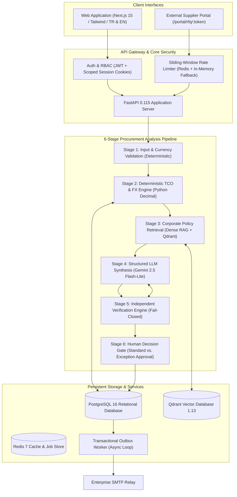

# ProcureOps AI

> **Evidence-Grounded B2B Procurement Decision Support & Autonomous Workflow Engine**

ProcureOps AI is a multi-tenant enterprise procurement platform engineered to automate request-for-quotation (RFQ) processing, supplier quote ingestion, multi-currency total cost of ownership (TCO) calculation, and corporate policy compliance.

Rather than delegating high-stakes financial calculations or compliance verdicts to probabilistic large language models (LLMs), ProcureOps AI implements a **two-tier hybrid architecture**:
1. **Deterministic Core:** Python `Decimal` arithmetic, currency exchange normalization, and strict rule enforcement calculate exact numbers and evaluate non-negotiable policy constraints.
2. **AI Reasoning & Retrieval:** Retrieval-Augmented Generation (RAG) over vector-indexed corporate governance documents and structured LLM orchestration synthesize trade-offs, extract unstructured documents, and provide cited, human-reviewable recommendations.

Every consequential action—such as purchase order generation and supplier awarding—remains governed by human-in-the-loop review, strict separation of duties, and an independent verification layer.

---

## Architecture Overview



---

## Key Capabilities

### 1. Document Intelligence & Multi-Format Extraction
- **Native PDF Extraction:** High-precision text and tabular layout extraction using `pdfplumber`.
- **Scanned PDF & Image OCR:** Automatic multimodal vision fallback via Google Gemini when text density falls below 50 characters or when handling raster images (`PNG`, `JPG`, `JPEG`).
- **Excel Ingestion:** Structured worksheet ingestion via `openpyxl` with `data_only=True` to resolve formulas into concrete values, generating markdown tables for downstream ingestion. Legacy binary `.xls` files are rejected fail-closed.
- **Arithmetic Discrepancy Auditing:** Computes expected item math (`quantity * unit_price`), subtotal comparisons, and grand total calculations. Discrepancies are flagged as audit warnings in quote notes without dropping valid data.
- **Idempotent Reprocessing:** Document reprocessing endpoint (`POST /api/v1/rfqs/{rfq_id}/quote-documents/{document_id}/reprocess`) permits re-extraction without orphaned or duplicate quote records.

### 2. Deterministic TCO & FX Currency Normalization
- **Strict Decimal Precision:** All financial calculations (`subtotal`, `vat`, `shipping`, `discount`, `other_fees`) are computed using Python `Decimal` types with standard commercial half-up rounding (`ROUND_HALF_UP`), avoiding IEEE 754 floating-point inaccuracies.
- **Multi-Currency Normalization:** Quotes submitted in foreign currencies (EUR, USD, GBP) are converted into the RFQ's target base currency.
- **Auditable Rate Paths:** The FX engine resolves conversion rates via direct, inverse, or cross-currency paths, persisting the exchange rate source (e.g., Central Bank rates), date, rate type, and human-readable audit notes in `tco_results`.
- **Fail-Closed Currency Guards:** If a foreign currency cannot be resolved via verified rates, the system refrains from numerical comparison and marks the compliance check as non-evaluable rather than fabricating numbers.

### 3. Corporate Policy Knowledge Base (Hybrid RAG)
- **Vector Search over Corporate Governance:** Policies, Service Level Agreements (SLAs), supplier codes of conduct, and framework contracts are chunked, embedded, and stored in Qdrant.
- **Topical Grounding & Citation Matching:** Policy searches enforce a similarity score threshold (default `0.65`). When relevant policy clauses are located, citations are linked by document name, section, and article.
- **Honest Insufficient Evidence Handling:** When corporate policies do not address a specific procurement criterion, the engine explicitly marks `insufficient_evidence` instead of hallucinatory compliance.

### 4. 6-Stage Sequential Analysis Pipeline
All RFQ analyses execute through a sequential, observable state machine:
1. **Stage 1 — Input & Currency Validation:** Validates that at least two valid quotes exist and verifies financial completeness before any external AI service invocation.
2. **Stage 2 — Deterministic TCO & Hard Rules:** Evaluates hard boundary constraints (maximum budget thresholds, maximum delivery timelines, minimum warranty duration, and mandatory certifications).
3. **Stage 3 — Policy Compliance Analysis:** Queries Qdrant for semantic matching against organizational guidelines.
4. **Stage 4 — Supplier Recommendation (LLM Synthesis):** Synthesizes operational trade-offs, reliability history, delivery commitments, and cost drivers into an `AgentRecommendationSchema`.
5. **Stage 5 — Independent Verification Layer:** Validates the LLM's claims against deterministic results and retrieved citations:
   - `passed`: All deterministic checks and policy citations are verified.
   - `failed`: Hard-rule violation detected; recommendation is revoked (`recommended_quote_id = None`).
   - `inconclusive`: Citations reference ungrounded or contradictory sources.
6. **Stage 6 — Human Decision Gate:** Human review controls final awarding.

### 5. Procurement Governance, RBAC & Exception Approval
- **Role-Based Access Control (RBAC):** Hierarchical permissions enforced across `admin`, `manager`, `purchasing_director`, `cfo`, `employee`, and `viewer`.
- **Multi-Tenant Isolation:** All data access is strictly scoped to the user's `organization_id`.
- **Exception Approval Workflow:** If a recommended supplier fails a hard compliance rule (e.g., budget exceeded by 5%), standard approval returns `HTTP 400 Bad Request`. Overriding this outcome requires an explicit `exception_approved` action by an authorized role, setting `acknowledged_policy_violation = True` along with mandatory justification.
- **Separation of Duties:** Approval endpoints enforce that the user who submitted the RFQ cannot unilaterally approve high-value orders without governance escalation.

### 6. Supplier Portal & Secure Quote Submission
- **Tokenized Access:** External vendors receive scoped magic links containing high-entropy tokens (`{delivery_id}.{raw_secret}`). The server validates the token against a SHA-256 cryptographic hash stored in the outbox metadata.
- **Zero Account Overhead:** Suppliers submit quotes directly without internal employee accounts.
- **Strict Data Isolation:** Suppliers only see the specific RFQ items they were invited to quote on. Internal budgets, competing quotes, policy documents, and AI analysis results are strictly redacted.

### 7. Reliable Asynchronous Email Processing (Transactional Outbox)
- **Atomic Event Persistence:** Outbound notifications (invitations, purchase order awards) are written atomically to the `email_deliveries` database table within the same transaction as the triggering business event, avoiding dual-write discrepancies.
- **Asynchronous Worker Loop:** An independent background worker polls pending records using `SELECT ... FOR UPDATE SKIP LOCKED` to prevent race conditions and duplicate processing across concurrent container replicas.
- **Bounded Exponential Backoff:** Transient socket or network failures trigger bounded exponential backoff (`retry_backoff * 2^(attempts-1)`). Permanent rejections (e.g., malformed recipient format) fail fast without retrying.
- **Idempotency Safeguards:** Enforced at the database level with a unique constraint on `idempotency_key` to guard against duplicate dispatch attempts during network retries.

### 8. Full Turkish/English Bilingual Architecture
- **Dual Presentation Dictionaries:** Complete UI parity (1,100+ keys) synchronized across Turkish (`tr`) and English (`en`).
- **Locale-Aware AI Analysis:** Prompts instruct the LLM to output analysis summaries, executive recommendations, and trade-off rationales in the active locale.
- **Dual Citation Verification:** Verification algorithms validate policy citations across English and Turkish terminologies.
- **Source Data Integrity:** Original supplier quotes and legal texts remain in their authentic source language while presentation labels, currency formats, and dates reflect the user's locale.

---

## Technology Stack

| Layer | Technologies |
|---|---|
| **Backend Framework** | Python 3.12, FastAPI 0.115, Pydantic v2, Pydantic-Settings |
| **Database & ORM** | PostgreSQL 16, SQLAlchemy 2.0 (asyncio, `asyncpg`), Alembic migrations |
| **Vector Database** | Qdrant 1.13.6 (dense vector indexing & cosine similarity) |
| **Cache & Queue** | Redis 7 (sliding-window rate limiting, session cache) |
| **AI & LLM Services** | Google Gemini (Gemini 2.5 Flash-Lite via Google GenAI SDK) |
| **Document Processing** | `pdfplumber` (PDF layout/tables), `openpyxl` (Excel), Gemini Multimodal Vision |
| **Frontend Framework** | Next.js 15 (App Router, Turbopack), React 19, TypeScript |
| **Styling & Components** | Tailwind CSS v4, Lucide React, Next-Themes |
| **Containerization** | Docker, Docker Compose (multi-stage build & non-root containers) |

---

## Project Structure

```
procureops-ai/
├── docker-compose.yml              # Local development compose (live mounts)
├── docker-compose.prod.yml         # Production compose (non-root, port isolation)
├── .env.example                    # Local environment variables template
├── .env.production.example         # Production environment template with security guidelines
├── .gitignore                      # Hardened ignore file
├── LICENSE                         # MIT License
├── DECISIONS.md                    # Architectural Decision Records (ADRs)
├── LEARNING.md                     # Engineering journal & system design reference
│
├── backend/
│   ├── Dockerfile                  # Development Dockerfile
│   ├── Dockerfile.prod             # Lean production Dockerfile
│   ├── pyproject.toml              # Dependencies & Ruff/pytest configurations
│   ├── alembic.ini                 # Database migration configuration
│   ├── migrations/                 # Alembic migration revisions
│   ├── app/
│   │   ├── main.py                 # FastAPI application entry & middleware
│   │   ├── core/                   # Security, JWT, rate limiting, and config
│   │   ├── db/                     # Async session factory & base models
│   │   ├── models/                 # SQLAlchemy ORM models (RFQ, Quote, Order, etc.)
│   │   ├── schemas/                # Pydantic validation schemas
│   │   ├── api/v1/                 # REST endpoints (auth, rfqs, quotes, portal, etc.)
│   │   └── services/               # Core business services:
│   │       ├── deterministic/      # TCO calculator, compliance rules, orchestrator
│   │       ├── fx/                 # Multi-currency exchange rate engine
│   │       ├── rag/                # Qdrant policy indexing and retrieval
│   │       ├── agent/              # LLM recommendation synthesis
│   │       ├── orchestration/      # 6-stage master pipeline
│   │       ├── extraction/         # PDF, OCR, and Excel parsing
│   │       └── email/              # Outbox models, providers, and worker loop
│   └── tests/                      # Automated test suite (unit, integration, regression)
│
├── frontend/
│   ├── Dockerfile                  # Development container configuration
│   ├── package.json                # Dependencies & scripts
│   ├── tsconfig.json               # TypeScript configuration
│   ├── scripts/                    # Parity check scripts (check-i18n-parity.mjs)
│   └── src/
│       ├── app/                    # Next.js 15 App Router pages & layouts
│       ├── components/             # UI components (analysis matrix, evidence panel, brand)
│       ├── lib/                    # i18n context, formatters, and API clients
│       └── locales/                # Bilingual translation dictionaries (en.json, tr.json)
│
└── scripts/
    ├── backup_db.py                # PostgreSQL backup utility (compressed -Fc)
    ├── backup_db.sh / .ps1         # Shell/PowerShell backup wrappers
    └── restore_db.sh / .ps1        # Shell/PowerShell restore wrappers
```

---

## Local Development Setup

### Prerequisites
- [Docker Desktop](https://www.docker.com/products/docker-desktop/) installed and running.
- [Git](https://git-scm.com/) installed.
- A Google AI Studio API key for LLM functionality ([Get API Key](https://aistudio.google.com/app/apikey)).

### Quick Start

1. **Clone the repository:**
   ```bash
   git clone https://github.com/betultaskiran/procureops-ai.git
   cd procureops-ai
   ```

2. **Configure environment variables:**
   ```bash
   cp .env.example .env
   ```
   Open `.env` in an editor and insert your Google Gemini API key:
   ```ini
   GEMINI_API_KEY=your_actual_gemini_api_key_here
   ```

3. **Start all services with Docker Compose:**
   ```bash
   docker compose up --build
   ```

4. **Verify running services:**
   - **Web Application:** [http://localhost:3000](http://localhost:3000)
   - **Backend API:** [http://localhost:8000](http://localhost:8000)
   - **Interactive API Docs (Swagger):** [http://localhost:8000/docs](http://localhost:8000/docs)
   - **Health Readiness Check:** [http://localhost:8000/health/ready](http://localhost:8000/health/ready)
   - **Qdrant Vector Console:** [http://localhost:6333/dashboard](http://localhost:6333/dashboard)

5. **Stop services:**
   ```bash
   docker compose down
   ```
   *(To wipe volumes and start from scratch, run `docker compose down -v`)*.

---

## Database Migrations & Administration

Alembic manages all schema revisions. Migrations execute inside the backend container:

```bash
# Check current migration revision
docker compose exec backend alembic current

# Upgrade to latest revision
docker compose exec backend alembic upgrade head

# Create a new migration revision
docker compose exec backend alembic revision --autogenerate -m "describe_changes"

# Downgrade by one revision
docker compose exec backend alembic downgrade -1
```

### Database Backup & Restore

Automated Python scripts generate timestamped, compressed custom-format dumps (`-Fc`):

```bash
# Generate a database backup
python scripts/backup_db.py --db procureops_db --out-dir backups

# Restore from a backup file
./scripts/restore_db.sh backups/procureops_backup_procureops_db_20261022_120000.dump
```

---

## Running the Automated Test Suite

### Backend Tests
Execute unit and integration tests inside the running backend container:

```bash
# Run the complete test suite
docker compose exec backend pytest

# Run workflow orchestration and email outbox tests
docker compose exec backend pytest tests/test_workflow_orchestration.py tests/test_email_integration.py

# Run rate limiting and order lifecycle tests
docker compose exec backend pytest tests/test_auth_rate_limit.py tests/test_order_lifecycle.py

# Run localization regression tests
docker compose exec backend pytest tests/test_p2_3_localization_fixes.py tests/test_p2_4_rule_checks_localization.py
```

### Frontend Tests & Type Checking

```bash
# Verify TypeScript compilation (zero errors)
npm --prefix frontend run type-check

# Verify 100% dictionary key parity between English and Turkish
npm --prefix frontend run check-i18n
```

---

## Transactional Outbox Background Worker

In development, emails can be inspected in the terminal or captured via a local SMTP receiver. To start the background worker process:

```bash
# Run continuous background worker loop
docker compose exec backend python -m app.services.email.worker

# Run a single batch pass (for CI/Cron)
docker compose exec backend python -m app.services.email.worker --once
```

---

## Security Architecture & Known Boundaries

- **Fail-Closed Configuration:** If `ENVIRONMENT=production` is specified, the application refuses to start if default development secret keys (`JWT_SECRET_KEY`) or placeholder database credentials are detected.
- **Port Exposure Policy:** In production (`docker-compose.prod.yml`), database (5432), cache (6379), and vector store (6333) ports have zero host exposure. Backend and frontend listen strictly on the host loopback (`127.0.0.1`), terminating behind an authorized reverse proxy (Nginx, Caddy, Cloudflare Tunnel).
- **Rate Limiting:** Authentication routes (`/login`, `/register`) enforce sliding-window rate limiting (10 requests per 60 seconds per client IP) backed by Redis atomic pipelines. If Redis is temporarily unreachable, an in-memory sliding window serves as fallback rather than failing open.
- **Proxy Spoofing Prevention:** The system ignores arbitrary `X-Forwarded-For` headers unless the direct socket peer IP matches an entry in `TRUSTED_PROXIES`.
- **RAG Grounding Boundary:** While Qdrant similarity search and dual citation verification significantly reduce hallucination, LLMs remain probabilistic. Production workflows mandate human review before committing financial funds or binding contracts.

---

## Project Status

| Area | Implementation Status |
|---|---|
| **Multi-Quote Ingestion & TCO** | Implemented (Decimal arithmetic, VAT, shipping, discounts) |
| **Deterministic Hard-Rule Engine** | Implemented (Delivery, warranty, budget, certifications) |
| **Multi-Currency FX Engine** | Implemented (Direct, inverse, cross rates with audit evidence) |
| **Hybrid Policy RAG** | Implemented (Dense vector search in Qdrant with thresholding) |
| **6-Stage Analysis Pipeline** | Implemented (Validation, TCO, RAG, LLM synthesis, verification, review) |
| **Transactional Outbox & Worker** | Implemented (Idempotent worker, exponential backoff, atomic dispatch) |
| **Supplier Quote Portal** | Implemented (Tokenized authentication, magic links, tenant isolation) |
| **RBAC & Exception Approval** | Implemented (6 roles, separation of duties, violation overrides) |
| **Bilingual Localization (TR/EN)** | Implemented (Full UI parity, locale-aware prompt synthesis) |
| **Automated Test Coverage** | Implemented (Automated backend test suite covering authentication, tenant isolation, quote processing, workflow orchestration, email delivery, policy retrieval, and localization, alongside frontend type-checking and translation parity checks) |
| **ERP / SAP Connectors** | Planned (Future roadmap integration via webhook architecture) |

---

## License

This project is released under the [MIT License](LICENSE).
